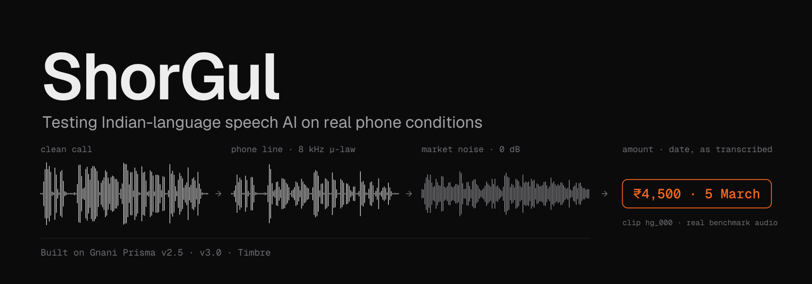
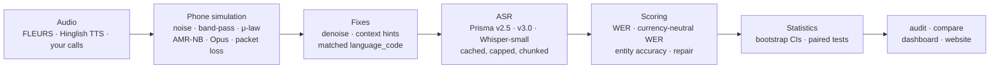

<p align="center"></p>

**ShorGul tests Indian-language speech recognition on phone calls and catches three failures ordinary WER misses: a wrong API setting, a bad phone line, and lost payment amounts.**

[](https://github.com/anurag-23werty/ShorGul/actions/workflows/shorgul.yml)

[](LICENSE)

**[Website](https://anurag-23werty.github.io/ShorGul/)** · [Detailed results](docs/RESULTS.md) · [Validation on real audio](results/validation.md) · [How the headline was checked](results/finding_check.md) · [Pilot protocol](docs/PILOT.md)

---

## The headline

**Gnani Prisma barely notices a bad phone line.** Band-limiting, μ-law, a real AMR-NB mobile codec, Opus VoIP, packet
loss and 10 dB noise caused no significant WER change in 52 of 56 Prisma model × language × condition cells. Only
0 dB crowd noise breaks it.

**What broke payment amounts was one API setting, and it failed silently.** With `language_code=en-IN`, Prisma v2.5
returns a normal, successful response for a Hinglish call, but every amount comes back as romanised words
("chaar hazaar paanch sau rupay"), which no CRM can read. Entity accuracy is **0%**. On the same audio with `hi-IN`
it's **94% [88, 100]**. Nothing errors and nothing logs a warning. Only an entity-level test catches it.

## Who uses it

| who | when | command |
|---|---|---|
| **Voice-bot team** | before go-live: grade the bot's audio under real call conditions, no reference transcripts needed | `shorgul audit ./calls --lang hinglish --max-calls 60` |
| **Solutions engineer** | in a deal: run the prospect's calls, send back one self-contained `report.html` with a grade and breaking point | `shorgul audit ./prospect_calls --lang hi --max-calls 125` |
| **ML team** | release gate: fail CI only if a new model or config is *significantly* worse (paired bootstrap) | `shorgul compare --baseline old.parquet --candidate new.parquet --metric entity --fail-on 2` |
| **Anyone storing money in transcripts** | turn spoken amounts and dates into written form, model-agnostic | `from shorgul.entities.repair import repair` · `repair("chaar hazaar paanch sau rupay")` → `₹4,500` |

Calls longer than the 30-second API limit are split at pauses automatically. The sample reports are
[Hindi](results/audits/sample_hindi_v3/report.html) (grade B, breaks at 0 dB market noise) and
[Hinglish](results/audits/sample_hinglish_v3/report.html) (grade A).

## Quickstart (5 minutes)

```bash
git clone https://github.com/anurag-23werty/ShorGul.git && cd ShorGul
uv venv --python 3.12 .venv && uv pip install --python .venv/bin/python -r requirements.txt -e .
#   (or: python3.12 -m venv .venv && .venv/bin/pip install -r requirements.txt -e .)
sudo apt-get install ffmpeg        # macOS: brew install ffmpeg

# 1. try it free: fake transcripts, no API key, no network
.venv/bin/shorgul audit samples/calls --lang hinglish --mock

# 2. the real thing: 6 bundled calls × 5 versions = 30 Gnani API calls (capped)
cp .env.example .env               # then put your GNANI_API_KEY in .env
.venv/bin/shorgul audit samples/calls --lang hinglish --model prisma-v3.0 --max-calls 30

open results/audits/calls/report.html    # Linux: xdg-open
```

### Dashboard

```bash
.venv/bin/streamlit run app/dashboard.py      # local for now; a hosted link will go here
```

`samples/` has 6 synthetic Hinglish customer-care calls and 20-second noise excerpts, so the audit runs without any
downloads. Every Gnani call is cached, so re-running costs nothing. `--max-calls` defaults to 0 (cache only).

## Findings

<!-- table:findings -->
| finding | number (95% CI) | test |
|---|---|---|
| One API setting decides whether amounts survive (Hinglish, same audio) | Prisma v2.5 entity accuracy, `hi-IN` − `en-IN`: **+93.6 [+86.2, +99.6] pts** | paired bootstrap, 25 clips × all conditions |
| Phone line, AMR-NB, Opus, packet loss, traffic, 10 dB market | no significant WER change in **52 of 56** Prisma model × language × condition cells | paired bootstrap vs clean, same clips |
| 0 dB market babble | significant WER increase in **7 of 8** Prisma cells (+2.7 to +15.3 pts) | paired bootstrap vs clean |
| Prisma v3.0 vs v2.5, read speech (Hindi) | WER +3.1 [+2.1, +4.2] pts (v3.0 − v2.5) | paired bootstrap, all conditions |
| Prisma v3.0 vs v2.5, read speech (Bengali) | WER +3.8 [+1.6, +6.6] pts (v3.0 − v2.5) | paired bootstrap, all conditions |
| Prisma v3.0 vs v2.5, read speech (Tamil) | WER +4.1 [+0.5, +8.7] pts (v3.0 − v2.5) | paired bootstrap, all conditions |
| Prisma v3.0 vs v2.5, Hinglish, same config (currency-neutral WER) | -1.7 [-5.1, +1.7] pts: tie | paired bootstrap |
| Prisma v3.0 vs v2.5, Hinglish, same config (entity accuracy) | +2.4 [+0.0, +6.9] pts: tie | paired bootstrap |
| Generic denoiser (spectral gating) before Prisma | WER significantly higher in **5 of 6** Prisma × language cells | paired bootstrap, noisy conditions pooled |
| Entity repair on unseen lines (Prisma v2.5 en-IN output) | 0% → **94 [90, 98]%** entity accuracy | held-out: 25 lines committed before any audio existed |
| Prisma v2.5 on 60 real phone calls (Gram Vaani, Hindi) | WER 16.1 [13.7, 19.0]% | bootstrap over calls |
| Prisma v3.0 on 60 real phone calls (Gram Vaani, Hindi) | WER 18.9 [16.2, 22.1]% | bootstrap over calls |
| Prisma v3.0 vs v2.5 on the same real calls | WER +2.7 [+0.3, +5.3] pts | paired bootstrap |
| Whisper-small, clean Hindi read speech | WER 79.3 [53.6, 109.2]% | bootstrap over clips |
| Whisper-small, clean Tamil read speech | WER 73.5 [61.8, 90.2]% | bootstrap over clips |
| Whisper-small, Bengali | writes Devanagari script in 99% of transcripts | script check per transcript |
<!-- /table:findings -->

Hinglish clips are synthetic (Gnani Timbre). Full tables, charts and every paired test are in
[docs/RESULTS.md](docs/RESULTS.md), and the real-audio checks are in [results/validation.md](results/validation.md).

## How it works



- **Audio:** FLEURS read speech (hi, bn, ta), 25 synthetic Hinglish call-centre lines, or a folder of your own calls.
- **Phone simulation:** noise is mixed at the caller, then the line: a 300–3400 Hz band-pass with 8 kHz μ-law, or AMR-NB 12.2 kbps, or Opus 8 kbps, plus packet loss. It's seeded per clip and condition.
- **Fixes:** a spectral-gating denoiser, Prisma v3.0 context hints, and the matched `language_code` comparison.
- **ASR:** every call goes through a sqlite cache keyed on the audio bytes, model and params, and calls over 30 s are split at pauses.
- **Scoring:** Indic-normalised WER and CER, currency-neutral WER (₹4,500 = 4,500 रुपये), amount and date accuracy, and entity repair.
- **Statistics:** 95% clip-level bootstrap CIs. Every model-vs-model claim is a paired bootstrap.
- **Products:** `shorgul audit` (an A–F grade from a label-free stability score), the `shorgul compare` release gate, a Streamlit dashboard, and the website.

## Engineering

- **Cost safety:** every billed call is cached and never sent twice, `--max-calls` defaults to 0, `--dry-run` counts calls first, a 429 triggers back-off, a 400 is logged and not retried, and a 403 is resent once as lossless FLAC.
- **Determinism:** degradation is seeded by `sha256(clip | condition)`, and every stage reads from and writes to disk, so any stage can be re-run on its own.
- **Tests:** 127 pytest tests, with no network and no API key. CI runs them plus the regression gate in mock mode on every push, and checks that the gate catches an injected regression.
- **Statistics, not vibes:** 1,140 paired tests behind the claims. A difference whose CI includes 0 is reported as a tie.
- **Honest numbers:** every table in this README and on the site is generated from `results/`, never typed by hand.
- **Secrets:** the API key is read from `.env` only, never logged or written to results, and a test checks this.

## Limitations

- **No real Hinglish customer calls.** The Hinglish set is synthetic speech. Real speech is covered by 60 Gram Vaani
  calls, which are Hindi community-radio callers, where Prisma v2.5 had 16.1% WER against 6.7% for read speech on the simulated line.
- **Dropout detection doesn't work on real calls** (AUC 0.52), and the simulated packet loss (zero-filled frames) is
  optimistic: real networks conceal lost packets.
- **The A–F grade is calibrated for Prisma only.** For Whisper the stability score doesn't track WER.
- **Entity repair covers ₹ amounts and dates only**, not account numbers, phone numbers or names. On unseen lines it
  scores 94%, against 100% on the lines it was built from.
- **Not a hosted service:** no accounts, batch API or PII handling. [docs/PILOT.md](docs/PILOT.md) describes the
  two-week pilot that would show whether the grades predict production.
- **25 clips per language,** so many differences are honestly reported as ties.

## Data & licences

| data | use | licence |
|---|---|---|
| Google FLEURS (hi, bn, ta test) | read-speech benchmark | CC BY 4.0 |
| Hinglish call-centre lines | written for ShorGul, voiced with Gnani Timbre v2.5 | project content |
| DEMAND (STRAFFIC, SPSQUARE, PCAFETER) | noise; 20 s excerpts bundled in `samples/noise` | CC BY-SA 3.0, doi:10.5281/zenodo.1227121 |
| Gram Vaani ASR challenge eval (OpenSLR 118) | 60 real phone calls, **reported as aggregate numbers only**; no audio or transcripts in this repo | free for academic use; commercial use needs permission |
| Geist / Geist Mono | banner and site type | SIL OFL 1.1 (`assets/fonts/OFL.txt`) |
| ShorGul code | everything else | MIT ([LICENSE](LICENSE)) |

Playable audio in this repo and on the site is FLEURS or synthetic TTS only.

## Credits

Built for **Gnani AI's Great Indian AI Internship Challenge (2026)** on Gnani Prisma v2.5, v3.0 and Timbre.
By **Anurag Choudhury** · [GitHub](https://github.com/anurag-23werty) · [LinkedIn](https://www.linkedin.com/in/anurag-choudhury-ai/)
