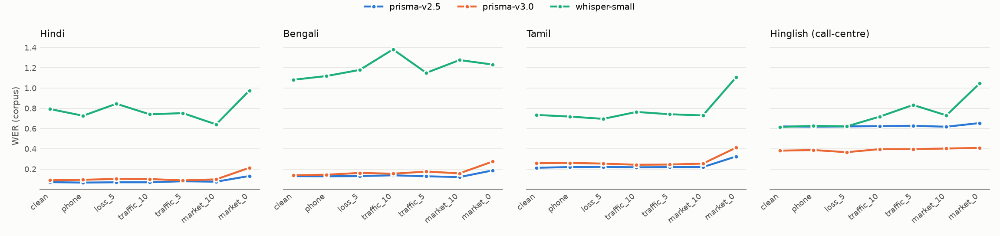
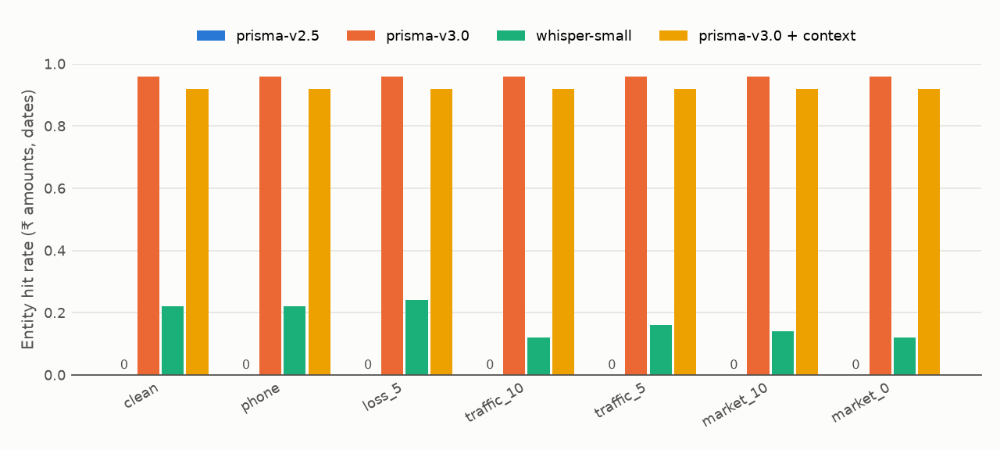
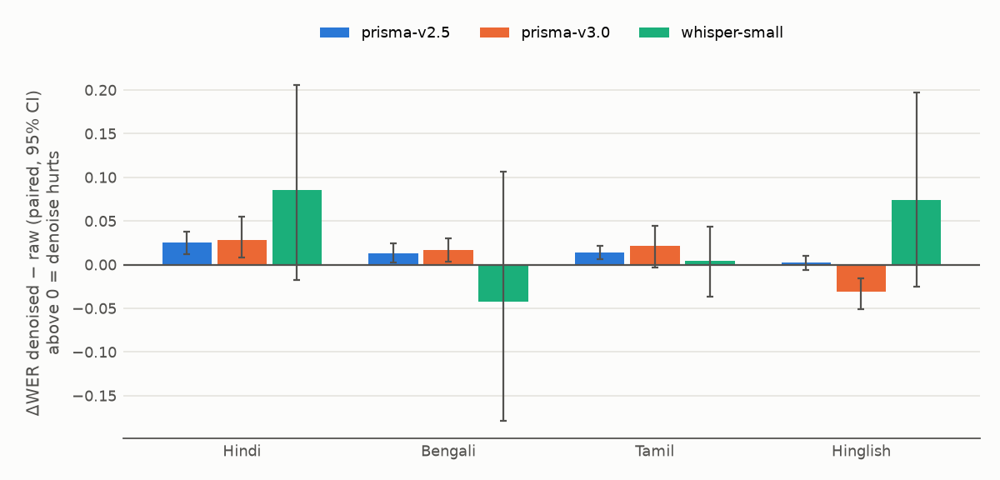

# ShorGul Bench

**An open benchmark for how Indian-language speech recognition breaks on real phone calls.**

*Shor-gul* (शोर-गुल) means "din, racket". Most ASR leaderboards score clean, wideband
read speech. Indian voice traffic doesn't sound like that: it's 8 kHz G.711 telephony,
dropped packets, and a caller standing next to an auto-rickshaw or a sabzi mandi. ShorGul
Bench takes clean speech, puts it through a reproducible simulation of an Indian phone call, and
measures how **Gnani Prisma v2.5**, **Prisma v3.0** and **Whisper-small** hold up, both on
word accuracy and on the thing a call-centre actually needs: *did the ₹ amount and the date
survive?*

> Entry for Gnani AI's Great Indian AI Internship Challenge (2026).

## Pipeline

```
clean 16 kHz speech
   │  FLEURS hi / bn / ta (25 clips each)  +  25 Hinglish call-centre lines (Gnani Timbre TTS)
   ▼
[1] background noise at target SNR      ← caller side, acoustic (DEMAND traffic / market)
[2] phone channel                       ← 300–3400 Hz band-pass → 8 kHz → G.711 μ-law → 16 kHz
[3] packet loss                         ← 20 ms frames dropped at random
   ▼
optional fixes:  denoise (spectral gating)  |  Prisma v3.0 domain context (topic + keyterms)
   ▼
ASR:  Prisma v2.5  ·  Prisma v3.0  ·  Whisper-small (local)
   ▼
score: WER · CER · entity hit rate · runaway (hallucination) rate · latency
   ▼
results/results.parquet  →  summary.csv  →  charts  +  Streamlit dashboard
```

The order matters. Noise is mixed **before** the phone channel because that's where it is
physically: in the caller's room. So the band-pass removes traffic rumble below 300 Hz but
keeps market chatter, which sits in the speech band. That's exactly what happens on a real call.

### Conditions

| condition | noise | SNR (acoustic) | phone channel | packet loss |
|---|---|---|---|---|
| `clean` | – | – | – | – |
| `phone` | – | – | ✓ | – |
| `loss_5` | – | – | ✓ | 5 % |
| `traffic_10` | street traffic | 10 dB | ✓ | – |
| `traffic_5` | street traffic | 5 dB | ✓ | – |
| `market_10` | public square + crowd chatter | 10 dB | ✓ | – |
| `market_0` | public square + crowd chatter | 0 dB | ✓ | – |

Every clip × condition is **deterministic**: seed = `sha256(clip_id | condition)`.
(Python's `hash()` is salted per process, so it can't be used.)

### Metrics

- **WER / CER** after Unicode NFC, native-digit → ASCII, punctuation/danda/₹ removal, and
  lower-casing. Group numbers are **corpus-level** (errors ÷ reference words), not a mean of
  per-clip ratios.
- **Hinglish WER**: models legitimately write the same words in Devanagari *or* Latin. Both
  sides are romanized (ITRANS + schwa deletion) before scoring, so a choice of script isn't
  counted as an error. This is approximate: `लोन` → `lon` ≠ `loan`. That's why the headline
  Hinglish metric is the next one.
- **Entity hit rate** (Hinglish): the share of reference entities (₹ amounts, dates, day numbers)
  reproduced *in written form* (`₹4,500`, `5 March`/`5 मार्च`, `5th`). Spoken-form numbers
  ("चार हज़ार पाँच सौ") don't count: a CRM can't use them. Prisma is called with
  `format=transcribe` (ITN) for these clips. FLEURS clips use `format=verbatim`.
- **Runaway rate**: the share of hypotheses more than 2× longer than the reference, counted in words or characters.
  This catches Whisper's repetition loops under heavy noise.
- **Wrong-script rate**: the share of hypotheses whose letters are mostly outside the language's
  own script. For example, Whisper-small often writes Bengali speech in Devanagari: phonetically close,
  but useless downstream.

## Results

100 clips × 7 conditions × 3 models, plus denoised and context variants: **3,475 transcripts, 0 failed**.
Full numbers are in `results/summary.csv`, and per-clip rows in `results/results.parquet`.



**Corpus WER, clean → `market_0` (0 dB crowd noise through a phone line):**

| | Hindi | Bengali | Tamil | Hinglish* |
|---|---|---|---|---|
| Prisma v2.5 | **7.1% → 13.2%** | **13.1% → 18.7%** | **21.3% → 32.5%** | 62.1% → 65.4% |
| Prisma v3.0 | 9.0% → 21.3% | 13.8% → 27.5% | 25.9% → 41.2% | 38.2% → 40.9% |
| Prisma v3.0 + context | – | – | – | **36.7% → 38.8%** |
| Whisper-small | 79.3% → 97.5% | 108% → 123% | 73.5% → 111% | 61.5% → 105% |

\*Hinglish WER is computed after romanization and is approximate (see Metrics). Use the entity table below for Hinglish.



**Hinglish entity hit rate** (did `₹4,500` and `5 मार्च` come out in usable written form?):

| | clean | market_0 |
|---|---|---|
| Prisma v3.0 (`hi-IN,en-IN`) | **96%** | **96%** |
| Prisma v2.5 (`hi-IN`, matched) | **94%** | **92%** |
| Prisma v3.0 + context | 92% | 92% |
| Whisper-small | 22% | 12% |
| Prisma v2.5 (`en-IN`) | 0% | 0% |

The v3.0 vs v2.5 (`hi-IN`) difference isn't significant (paired bootstrap, 95% CI [+0.0, +6.6] pts).
The 0% row is a **config effect, not a model limit**. See [`results/finding_check.md`](results/finding_check.md).



### Findings

1. **The phone line itself is almost free for Prisma.** Band-limiting, 8 kHz μ-law and 5% packet
   loss move Prisma's WER by at most 2.4 points (v2.5: at most 0.9). Both Prisma models stay nearly flat
   through `traffic_5` and `market_10` (within 4 points of clean). Only **0 dB babble** (`market_0`) breaks
   them.
   Babble sits in the speech band and survives the 300–3400 Hz channel, while traffic
   rumble mostly doesn't.
2. **On verbatim read speech, v2.5 beats v3.0, and the gap widens in noise** (Hindi `market_0`:
   13.2% vs 21.3%). Error diffs show that v3.0 splits and merges compounds differently (Tamil
   "சுட்டுக் கொல்லப்பட்டார்") and misrecognizes more words under 0 dB babble. CER shows the same
   ordering, so this isn't a word-boundary artifact.
3. **The eval config picks the winner, not the model.** On identical Hinglish audio, switching
   v2.5's `language_code` from `en-IN` to `hi-IN` moved its entity accuracy from **0% to 94%**. Under
   that matched config, v2.5 and v3.0 are statistically tied on entities (94% vs 96%) and on
   convention-neutral WER (32.2% vs 30.8%, CI [−4.7, +1.8] pts). The as-scored WER gap comes only from
   v3.0 writing `4,500 रुपये` where the reference writes `₹4,500`. Both models hold entity accuracy
   flat from clean to 0 dB market noise. Whisper-small writes numbers as words: 22% → 12%.
4. **Domain context helps words, not numbers.** Keyterms fixed `ईएमआई → EMI` and lowered Hinglish
   WER at every condition (38.2% → 36.7% clean, 40.9% → 38.8% at `market_0`). But on one clip, number formatting
   wasn't applied with context ("चालीस हज़ार" instead of "40,000"), so entity accuracy dipped 96% → 92%.
5. **Classic denoising hurts on real speech.** On recorded FLEURS speech, spectral gating on the
   received audio raised Prisma's WER in 22 of 24 language × model × noise cells. It was unchanged
   in one and 0.8 points lower in one. The worst case was +7.4 points (Hindi, `market_0`, both models). It also
   cut Whisper's Hinglish entity accuracy at `market_0` from 12% to 4%. The one exception is
   *synthetic* Hinglish speech with v3.0 (−9.1 points at `market_0`). Clean TTS voices are easy to
   separate from noise, so that result likely won't transfer to real callers. Modern ASR models are trained
   on noisy audio, and gating strips cues they rely on. *Don't put a generic denoiser in front of Prisma.*
6. **Whisper-small isn't a viable baseline for Indic telephony.** It writes Bengali speech in
   Devanagari 99% of the time, falls into repetition loops in 4–10% of clips, and runs at
   ~6.7 s per clip on CPU. Prisma's median API round-trip is ~0.3 s.

Remaining errors that a CRM would feel (Prisma v3.0, clean): `18 अगस्त → 1 August` and
`31 मई → 3/1/May`. Number formatting writes a malformed date even when the words are heard correctly.

**Reliability note:** 3 requests (one clip, clean audio only) returned `403` for its WAV bytes.
They were resent once as lossless FLAC (identical samples) and succeeded. These rows are marked
`sent_as: flac_after_403` in the cache.

## Quickstart

```bash
uv venv --python 3.13 .venv && uv pip install --python .venv/bin/python -r requirements.txt
cp .env.example .env            # add GNANI_API_KEY (never committed)

# 1. data: FLEURS subset + DEMAND noise (free); Hinglish TTS is billed → capped
python -m shorgul.cli prepare
python -m shorgul.cli prepare --langs "" --tts --max-calls 25 --no-noise

# 2. simulate calls, 3. denoise
python -m shorgul.cli degrade
python -m shorgul.cli enhance

# 4. transcribe: ALWAYS dry-run first; billed calls are capped by --max-calls
python -m shorgul.cli run --variants raw,denoised,context --dry-run
python -m shorgul.cli run --models whisper-small --variants raw,denoised     # local, free
python -m shorgul.cli run --models prisma-v3.0 --langs hi --max-calls 200

# 5. score + charts, 6. explore
python -m shorgul.cli score
streamlit run app/dashboard.py
```

**Try the whole thing without credits:** `run --mock` returns deterministic fake
transcripts (worse on harder conditions) and writes to `results/mock/`, a separate cache
and results folder that never mixes with real data. Then run `score --mock`, and the dashboard's *Data* switch shows it.

## Cost and safety rails

- **Every billed call goes through `results/cache.sqlite`**, keyed by
  `sha256(audio bytes + model + params)`. A key is never sent twice; re-running any stage is free.
- `--max-calls` caps **new** billed requests per run (default `0` = cache only). `--dry-run`
  prints cached-vs-needed counts per model.
- Prisma calls are sequential. `429 RATE_LIMITED` → exponential back-off (1, 2, 4, 8, 16 s).
  `400/422` → logged, not retried, and cached as an error so it isn't re-billed.
  `truncated: true` → status `ok_truncated`.
- The API key is read from `.env` only, and is never logged or written to results. A test checks this.
- Each stage reads from and writes to disk (`data/clean`, `data/degraded`, `data/enhanced`,
  `results/hyps.parquet`, `results/results.parquet`), so any stage can be re-run on its own.

## Design notes

- **Context variant without leakage**: the Prisma v3.0 `topic`/`keyterms` are one fixed,
  domain-level list (EMI, KYC, UPI, किस्त, …) in `configs/bench.yaml`. They are **never**
  derived from a clip's own reference or entities.
- **Denoising is applied where a vendor could apply it**: to the received 8 kHz-band audio,
  after the channel. Spectral gating can *hurt* ASR by smearing consonants, and the benchmark
  reports that honestly (ΔWER chart).
- **SNR is measured on active speech** (frames within 40 dB of the loudest), so FLEURS'
  leading and trailing silence doesn't inflate the effective SNR. Speech and noise are scaled
  together to avoid clipping, which leaves the SNR exact.
- **FLEURS without the deprecated loading script**: the loader streams
  `test.tar.gz` from the Hub and stops after 25 clips (≤ 25 s, one per sentence), instead of
  downloading 250 MB per language.

## Layout

```
configs/bench.yaml        conditions, language codes, context, paths
shorgul/data/             FLEURS loader, Timbre TTS, DEMAND noise, Hinglish script
shorgul/degrade/          noise @ SNR, phone channel (ffmpeg μ-law), packet loss, pipeline
shorgul/enhance/          spectral-gating denoise
shorgul/asr/              Prisma client, Whisper-small, mock, sqlite cache, job runner
shorgul/metrics/          normalization, WER/CER, entities, aggregation, charts
shorgul/cli.py            prepare | degrade | enhance | run | score
app/dashboard.py          Streamlit dashboard
tests/                    pytest (no network, no credits)
```

## Data and licences

- **FLEURS** (Google), CC BY 4.0: `google/fleurs`, test split, `hi_in`, `bn_in`, `ta_in`.
- **DEMAND** (Thiemann, Ito, Vincent, 2013), CC BY-SA 3.0: Zenodo 10.5281/zenodo.1227121.
  `traffic` = STRAFFIC ch01; `market` = SPSQUARE + PCAFETER ch01, mixed.
- **Hinglish call-centre lines**: written for this benchmark and synthesized with Gnani Timbre v2.5
  (voices Nalini, Deepak, Bhavna, Roopesh).

Odia isn't included because Prisma doesn't support it yet.
