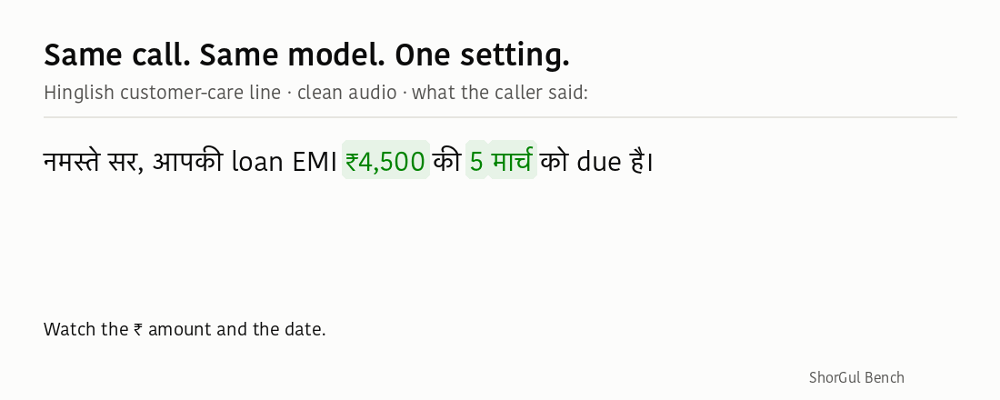
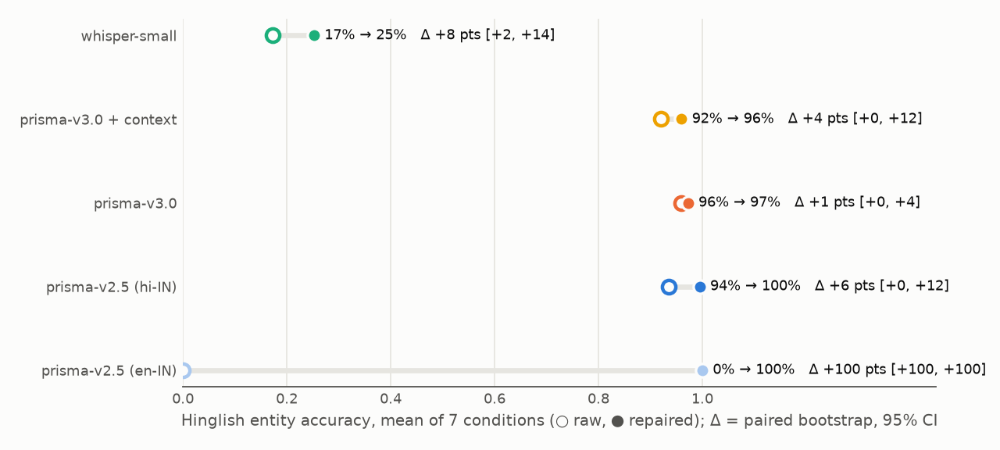
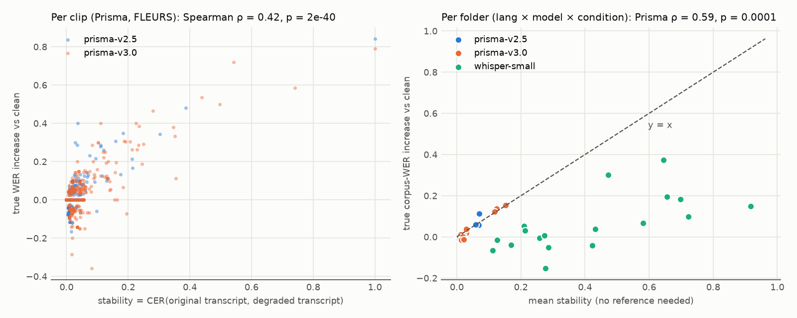

<p align="center"></p>

# ShorGul

**WER misleads Indian voice-AI teams, and here's the fix.**

ShorGul (शोर-गुल, "din, racket") is a telephony-robustness and entity-accuracy testing tool for Indian-language
speech recognition. It simulates real Indian phone calls (8 kHz μ-law, packet loss, street and market noise, 8 kbps Opus VoIP),
scores what a call-centre actually needs (did the **₹ amount** and the **date** survive?), and puts honest
confidence intervals on every claim.



> Entry for Gnani AI's Great Indian AI Internship Challenge (2026). **Built on Gnani Prisma v2.5, v3.0 and Timbre.**

---

## The finding: your eval config picks the winner, not the model

On **identical** Hinglish customer-care audio:

- **One request parameter decides entity accuracy.** Prisma v2.5 with `language_code=en-IN` returns romanized
  number words ("chaar hazaar paanch sau rupay") and gets **0%** of amounts and dates right. The same model with
  `hi-IN` writes "₹4,500" and gets about **94%**.
- **One reference-writing convention decides the WER winner.** Under a matched config, v2.5 "beats" v3.0 on WER
  by 5.9 pts (significant). But that's only because v3.0 writes `4,500 रुपये` where our reference writes `₹4,500`.
  Neutralize the currency word and it's a **statistical tie**, and entity accuracy is a tie too.

**Hinglish entity accuracy, clean → `market_0`** (95% bootstrap CI over clips):

<!-- table:entity -->
| | clean | market_0 |
|---|---|---|
| Prisma v3.0 (`hi-IN,en-IN`) | 96.0% [90.0, 100.0] | 96.0% [90.0, 100.0] |
| Prisma v2.5 (`hi-IN`, matched) | 94.0% [88.0, 100.0] | 92.0% [84.0, 98.0] |
| Prisma v3.0 (`hi-IN`, matched) | 96.0% [90.0, 100.0] | 96.0% [90.0, 100.0] |
| Prisma v3.0 + context | 92.0% [82.0, 100.0] | 92.0% [82.0, 100.0] |
| Whisper-small | 22.0% [8.0, 38.0] | 12.0% [4.0, 24.0] |
| Prisma v2.5 (`en-IN`) | 0.0% [0.0, 0.0] | 0.0% [0.0, 0.0] |
<!-- /table:entity -->

So with default settings and WER alone, a team can pick, or reject, the wrong model. ShorGul makes the config,
the call conditions and the entities part of the test. The full verification is in
[`results/finding_check.md`](results/finding_check.md).

## The fix: entity repair

`shorgul.entities.repair` is a model-agnostic post-processor that rewrites spoken-form amounts and dates
(*chaar hazaar paanch sau rupay → ₹4,500*, *चालीस हज़ार रुपये → ₹40,000*, *1 8 अगस्त → 18 अगस्त*,
*3/1/May → 31 May*). It only converts **in an entity context**, so *do teen log* and *kar do* are left alone. It
has 66 unit tests, and across 4,955 transcripts (dev set, held-out set, 60 real phone calls) it produced
**0 entity regressions**. The table below is the dev set it was built on (in-sample). On **25 held-out lines written and
committed before any audio existed**, it took Prisma v2.5 (`en-IN`) from 0% to **94% [90, 98]**, against 100% in-sample.
See [`results/validation.md`](results/validation.md).

<!-- table:repair -->
| model (Hinglish) | entity acc. raw → repaired | Δ entity [95% CI] | Δ WER as scored | Δ WER currency-neutral |
|---|---|---|---|---|
| Prisma v2.5 (`en-IN`) | 0% → 100% | +100.0 [+100.0, +100.0] * | -36.6 [-41.4, -31.8] * | -29.5 [-34.0, -25.1] * |
| Prisma v2.5 (`hi-IN`) | 94% → 100% | +6.0 [+0.0, +12.0] | -1.8 [-3.9, +0.0] | -1.8 [-3.9, +0.0] |
| Prisma v3.0 | 96% → 97% | +1.3 [+0.0, +4.0] | -7.7 [-8.9, -6.6] * | -0.4 [-1.3, +0.0] |
| Prisma v3.0 + context | 92% → 96% | +4.0 [+0.0, +12.0] | -7.9 [-9.4, -6.6] * | -0.6 [-1.8, +0.0] |
| Whisper-small | 18% → 25% | +7.8 [+2.4, +14.2] * | -3.3 [-5.6, -1.4] * | -3.3 [-5.6, -1.4] * |
<!-- /table:repair -->

`*` = significant (paired bootstrap). **Honest positioning:** on Prisma output with `format=transcribe`, Gnani's own
formatting already writes amounts correctly, so repair adds little there. Repair is the fix for **verbatim or romanized
output and other vendors' models**, and for the **split-date bugs** formatting leaves behind. It can't recover a
misheard number (`18 अगस्त → 1 August`). See [`results/repair_report.md`](results/repair_report.md).



## Three ways to use it

**1. Bench: reproduce the numbers** (developers)
```bash
python -m shorgul.cli prepare                          # FLEURS subset + DEMAND noise (free)
python -m shorgul.cli degrade && python -m shorgul.cli enhance
python -m shorgul.cli run --variants raw,denoised --dry-run        # count calls first
python -m shorgul.cli run --models prisma-v3.0 --langs hi --max-calls 300
python -m shorgul.cli score && streamlit run app/dashboard.py
```

**2. Audit: grade a customer's own audio** (solutions team)
```bash
python -m shorgul.cli audit calls/ --lang hinglish --model prisma-v3.0 --max-calls 60
# -> results/audits/calls/report.html : grade A–F, breaking point, nearest benchmark condition,
#    fixes with evidence, 3 least-stable clips with diffs + audio. One self-contained file.
```
It needs no reference transcripts. The grade comes from **stability**, the CER between the transcript of the original audio and of
simulated call conditions, which is validated against true WER increase (below). Try it free with `--mock`.
Samples: [Hindi](results/audits/sample_hindi_v3/report.html) (grade B, breaks at 0 dB market),
[Hinglish](results/audits/sample_hinglish_v3/report.html) (grade A).

**3. Compare: a regression gate in CI** (ML team)
```bash
python -m shorgul.cli compare --baseline old.parquet --candidate new.parquet --metric entity --fail-on 2
# exits 1 only if the candidate is significantly worse (paired bootstrap) by >= 2 pts
```
On the real benchmark, the gate **fails** a v2.5 → v3.0 swap on FLEURS WER (+3.2 to +4.2 pts, significant in all three
languages) and **passes** it on matched Hinglish entities (tie). `.github/workflows/shorgul.yml` runs the tests and
the gate in mock mode on every push, and checks that the gate catches an injected regression.

## Results

100 clips (25 each of Hindi, Bengali and Tamil from FLEURS, plus 25 Hinglish call-centre lines voiced with Gnani Timbre) ×
9 conditions (7 PSTN-style, 8 kbps Opus VoIP, AMR-NB 12.2 kbps mobile) × 3 models, plus denoised, context and
matched-config variants. Together with the held-out lines and 60 real phone calls (below): **4,955 transcripts, 0 failed.**
Every table here is generated from `results/summary.csv` and `results/comparisons.csv`
(`python -m shorgul.cli readme-tables`).


**Corpus WER, clean → `market_0`:**

<!-- table:wer -->
| | Hindi | Bengali | Tamil | Hinglish* |
|---|---|---|---|---|
| Prisma v2.5 | 7.1% [4.5, 10.0] → 13.2% [9.1, 17.4] | 13.1% [9.2, 17.3] → 18.7% [11.4, 28.4] | 21.3% [16.1, 26.6] → 32.5% [25.4, 40.8] | 62.1% [56.1, 69.0] → 65.5% [59.4, 72.2] |
| Prisma v3.0 | 9.0% [5.8, 12.6] → 21.3% [15.0, 28.1] | 13.8% [9.9, 18.5] → 27.5% [19.4, 38.1] | 25.9% [20.2, 32.4] → 41.2% [32.7, 51.9] | 38.2% [34.3, 42.7] → 40.9% [35.9, 46.2] |
| Prisma v3.0 + context | – | – | – | 36.7% [31.7, 42.0] → 38.8% [33.4, 44.4] |
| Whisper-small | 79.3% [53.6, 109.2] → 97.5% [78.8, 123.2] | 108.2% [104.1, 112.8] → 123.2% [102.3, 151.6] | 73.5% [61.8, 90.2] → 110.8% [95.2, 132.0] | 61.5% [52.8, 70.2] → 104.6% [83.5, 132.3] |
<!-- /table:wer -->

\*Hinglish WER is computed after romanization, with v2.5 in its `en-IN` config. Read Hinglish through the entity table.

**Does the phone line hurt? WER change vs clean, same model, same clips** (pts; `*` = significant):

<!-- table:degradation -->
| model | lang | phone | loss_5 | traffic_10 | traffic_5 | market_10 | market_0 | opus_voip | amrnb_mobile |
|---|---|---|---|---|---|---|---|---|---|
| prisma-v2.5 | bn | -0.2 | +0.0 | +0.8 | -0.2 | -1.0 | +5.7* | -0.6 | -0.8 |
| prisma-v2.5 | hi | -0.4 | -0.1 | -0.1 | +0.9 | +0.4 | +6.1* | +0.0 | +0.1 |
| prisma-v2.5 | hinglish | -0.3 | +0.0 | +0.3 | +0.6 | -0.3 | +3.3* | -0.3 | -0.3 |
| prisma-v2.5 | ta | +0.7 | +0.9 | +0.5 | +0.7 | +0.7 | +11.2* | +1.4 | +0.5 |
| prisma-v3.0 | bn | +0.6 | +2.3* | +1.6 | +3.7* | +1.9 | +13.7* | +3.7* | +2.9* |
| prisma-v3.0 | hi | +0.4 | +1.3 | +1.2 | -0.1 | +0.9 | +12.3* | +1.2 | +0.9 |
| prisma-v3.0 | hinglish | +0.6 | -1.5 | +1.5 | +1.5 | +2.1 | +2.7 | +0.0 | +0.0 |
| prisma-v3.0 | ta | +0.2 | -0.5 | -1.6 | -1.4 | -0.5 | +15.3* | +0.9 | +0.0 |
<!-- /table:degradation -->

What the data supports:
1. **The phone line is almost free for Prisma.** Band-limiting, μ-law, 5% packet loss, traffic at 10/5 dB and market at 10 dB
   cause no significant WER change in 38 of 40 Prisma model × language × condition cells. **0 dB market babble** breaks both
   models, because babble sits in the speech band and survives the channel. Hinglish entity accuracy doesn't change significantly
   under any condition.
2. **WhatsApp-style VoIP (Opus 8 kbps) is almost free too:** no significant WER change in 7 of 8 Prisma model ×
   language cells. The exception is v3.0 Bengali (+3.7 pts, significant). Hinglish entity accuracy is unchanged. The real
   **AMR-NB 12.2 kbps** mobile codec is no worse than the μ-law line in 7 of 8 Prisma cells (v3.0 Bengali +2.3, significant).
3. **On verbatim read speech, v2.5 has lower WER than v3.0**, significant pooled over conditions in all three
   languages (a tie on clean Bengali), and the gap widens at 0 dB.
4. **Don't put a generic denoiser in front of Prisma.** Spectral gating significantly *raised* WER in 5 of 6 Prisma ×
   language cells on real speech.
5. **Context hints:** no significant effect on 25 clips.
6. **Whisper-small isn't a viable baseline for Indic telephony.** It writes Bengali in Devanagari 99% of the time and loops on
   noise.


<details><summary><b>Every comparison the claims rely on</b> (paired bootstrap, A − B)</summary>

<!-- table:claims -->
| claim (A − B) | lang | conditions | metric | Δ (pts) | 95% CI | verdict |
|---|---|---|---|---|---|---|
| v3.0 vs v2.5 | hi | all | WER | +3.1 | [+2.1, +4.2] | prisma-v2.5/raw better (significant) |
| v3.0 vs v2.5 | bn | all | WER | +3.8 | [+1.6, +6.6] | prisma-v2.5/raw better (significant) |
| v3.0 vs v2.5 | ta | all | WER | +4.1 | [+0.5, +8.7] | prisma-v2.5/raw better (significant) |
| v3.0 vs v2.5 | hi | clean | WER | +1.9 | [+0.6, +3.4] | prisma-v2.5/raw better (significant) |
| v3.0 vs v2.5 | bn | clean | WER | +0.8 | [-1.9, +3.6] | tie (not significant) |
| v3.0 vs v2.5 | ta | clean | WER | +4.6 | [+0.7, +9.7] | prisma-v2.5/raw better (significant) |
| v3.0 matched vs v2.5 matched | hinglish | all | WER | +5.6 | [+2.2, +9.0] | prisma-v2.5/matched better (significant) |
| v3.0 matched vs v2.5 matched | hinglish | all | WER (currency-neutral) | -1.7 | [-5.1, +1.7] | tie (not significant) |
| v3.0 matched vs v2.5 matched | hinglish | all | entity acc. | +2.4 | [+0.0, +6.9] | tie (not significant) |
| v3.0 context vs v3.0 raw | hinglish | all | WER | -2.2 | [-5.5, +0.6] | tie (not significant) |
| v3.0 context vs v3.0 raw | hinglish | all | entity acc. | -4.0 | [-12.0, +0.0] | tie (not significant) |
| prisma-v2.5 denoised vs raw | hi | all | WER | +2.5 | [+1.2, +3.8] | prisma-v2.5/raw better (significant) |
| prisma-v2.5 denoised vs raw | bn | all | WER | +1.3 | [+0.3, +2.4] | prisma-v2.5/raw better (significant) |
| prisma-v2.5 denoised vs raw | ta | all | WER | +1.4 | [+0.6, +2.2] | prisma-v2.5/raw better (significant) |
| prisma-v2.5 denoised vs raw | hinglish | all | WER | +0.2 | [-0.6, +1.0] | tie (not significant) |
| prisma-v3.0 denoised vs raw | hi | all | WER | +2.9 | [+0.8, +5.5] | prisma-v3.0/raw better (significant) |
| prisma-v3.0 denoised vs raw | bn | all | WER | +1.7 | [+0.4, +3.0] | prisma-v3.0/raw better (significant) |
| prisma-v3.0 denoised vs raw | ta | all | WER | +2.2 | [-0.3, +4.5] | tie (not significant) |
| prisma-v3.0 denoised vs raw | hinglish | all | WER | -3.1 | [-5.1, -1.6] | prisma-v3.0/denoised better (significant) |
| whisper-small denoised vs raw | hi | all | WER | +8.5 | [-1.8, +20.6] | tie (not significant) |
| whisper-small denoised vs raw | bn | all | WER | -4.2 | [-17.9, +10.7] | tie (not significant) |
| whisper-small denoised vs raw | ta | all | WER | +0.4 | [-3.7, +4.4] | tie (not significant) |
| whisper-small denoised vs raw | hinglish | all | WER | +7.4 | [-2.5, +19.7] | tie (not significant) |
<!-- /table:claims -->
</details>

**Stability is a valid label-free proxy for Prisma:**



Per folder, mean stability tracks the true WER increase (Spearman ρ = 0.59, p = 0.00015) and sits near y = x.
It is **not** calibrated for Whisper, whose output churns without getting proportionally worse.

## Validation: what changed when we tested on real audio

Four checks run after the benchmark, to replace assumptions with measurements. Full tables:
[`results/validation.md`](results/validation.md).

| check | result |
|---|---|
| **Entity repair on unseen lines** (25 lines, 42 entities, committed before any audio; code frozen) | Prisma v2.5 `en-IN`: 0% → **94% [90, 98]** (100% in-sample). 0 entity regressions on 4,955 transcripts |
| **60 real phone calls** (Gram Vaani, OpenSLR 118: spontaneous Hindi, rural callers) | Prisma v2.5 **16.1%** WER [13.7, 19.0], v3.0 **18.9%** [16.2, 22.1]: about 2× the simulated phone condition on read speech (6.7%, 9.4%). v2.5 beats v3.0 here too (+2.7 pts [+0.3, +5.3], paired) |
| **Real dropouts** (annotator-flagged) vs clean lines | no significant WER difference for Prisma (v2.5 +0.0 [−4.8, +5.1]; v3.0 +1.0 [−4.7, +7.0]) |
| **Real AMR-NB codec** vs simulated μ-law line | no significant difference in 7 of 8 Prisma cells |
| **Calls longer than 30 s** (78 s, 4 chunks split at pauses) | 96% of 25 amounts and dates kept, same as line by line (96.4%). One call: a smoke test |
| **What broke** | the dropout detector (AUC 0.52 on real calls); zero-filled packet loss is optimistic |

The real-call gap mixes channel with speaking style (spontaneous, regional speech vs read sentences), so it shows how
much harder real calls are, not how much of that is the phone line. Gram Vaani is free for academic use only.

## Architecture

```
clean speech ── FLEURS hi/bn/ta · Hinglish lines → Gnani Timbre TTS
    │
    ├─ degrade/   noise @ SNR (caller side) → 300–3400 Hz → 8 kHz μ-law (ffmpeg) → packet loss · Opus 8 kbps VoIP
    ├─ enhance/   spectral-gating denoise (the "fix" that isn't)
    ├─ asr/       Prisma v2.5 / v3.0 client (backoff, FLAC-on-403) · Whisper-small · mock
    │             └─ every billed call → sqlite cache (sha256 of audio + model + params), --max-calls cap
    ├─ metrics/   Indic normalization · WER/CER · currency-neutral WER · entity accuracy
    ├─ entities/  entity repair (anchored number/date parser)
    ├─ stats/     clip-level bootstrap CIs · paired cluster bootstrap
    ├─ audit/     stability score · health check · report.html      ← `shorgul audit`
    ├─ compare.py paired regression gate                            ← `shorgul compare`
    └─ app/       Streamlit dashboard (finding · fix · degradation · listen · try your audio · audit · method)
```

**Cost and safety rails:** every Gnani call goes through the cache, so nothing is billed twice. `--max-calls` defaults to 0 (cache only), and
`--dry-run` prints planned calls. On 429 the client backs off; on 400 it logs and doesn't retry. The API key is read from `.env` only,
never logged or written to results, and a test checks this. The whole benchmark used about 3,000 Gnani calls.

## Method and limitations

- **Conditions:** DEMAND noise mixed at the caller at an acoustic SNR measured on active speech, then a 300–3400 Hz
  band-pass, 8 kHz G.711 μ-law via ffmpeg, and 5% random 20 ms packet loss. `opus_voip` is a libopus round trip at 8 kbps
  in VoIP mode, with no PSTN channel. Deterministic: seed = sha256(clip | condition).
- **Metrics:** corpus WER/CER after NFC, native digits → ASCII, punctuation/danda/₹ removal, and Devanagari nukta/chandrabindu
  folding. Hinglish is compared after romanization. Currency-neutral WER drops ₹/रुपये words from both sides.
- **Statistics:** 95% percentile bootstrap over clips (1,000 resamples). Model-vs-model claims use a paired cluster
  bootstrap. "Significant" means the CI excludes 0.
- **Limitations:**
  - **25 clips per language**, so many differences are honestly reported as ties.
  - **Hinglish is synthetic TTS speech** (dev and held-out). Real speech is covered only by 60 Gram Vaani phone calls,
    which are Hindi community-radio callers, not Hinglish customer care.
  - **Simulated packet loss is optimistic.** `loss_5` zero-fills lost frames; real networks conceal them, and the
    health check's dropout detector fails on real dropouts (AUC 0.52). Echo and AGC aren't simulated.
  - **Romanized WER is approximate.**
  - **The v2.5 `en-IN` config followed the original project spec.** It's kept on purpose as the default-style example.

## Data and licences

- **FLEURS** (Google), CC BY 4.0.
- **DEMAND** (Thiemann, Ito, Vincent, 2013), CC BY-SA 3.0, Zenodo 10.5281/zenodo.1227121.
- **Hinglish lines:** written for this project and voiced with Gnani Timbre v2.5.
- Odia isn't included because Prisma doesn't support it.

```bash
uv venv --python 3.13 .venv && uv pip install --python .venv/bin/python -r requirements.txt
cp .env.example .env    # GNANI_API_KEY=...   (never committed)
python -m pytest -q     # no network, no API key needed
```
